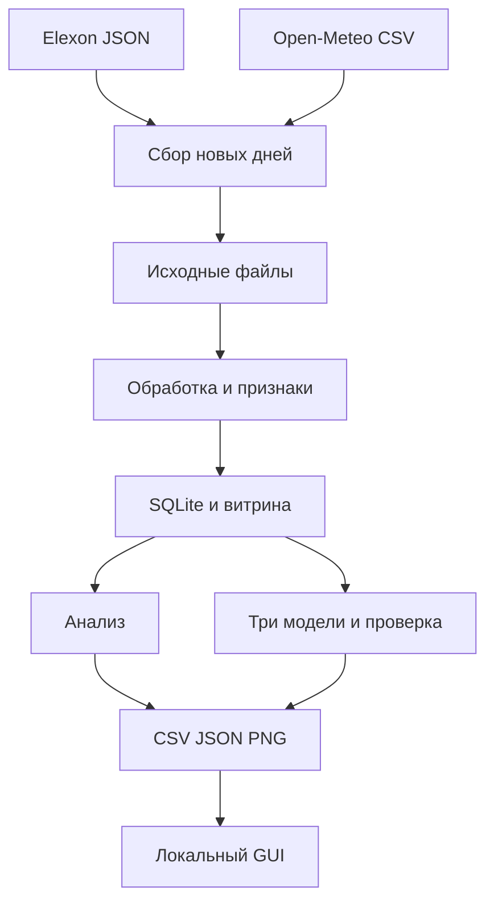

# EnergyScope

Единый учебный проект по дисциплинам «Проектирование аналитических систем» и «Прогнозно-аналитические системы». Автор: Сенникова Алёна, ИМБО-10-23.

Программа получает нагрузку энергосистемы Великобритании и погоду Лондона, хранит исходники и почасовую витрину, исследует сезонность, сравнивает три прогноза и показывает результат с оценкой неопределённости. Отчёты по предметам оформлены отдельно.

## Быстрый запуск в Windows

1. Установить Python 3.12 с официального сайта, если его нет. При установке включить Add Python to PATH.
2. Полностью распаковать архив. Не запускать файлы внутри ZIP.
3. Дважды щёлкнуть `start_windows.bat`. При первом запуске нужен интернет для установки зависимостей. В дальнейшем программа откроет сохранённые результаты.
4. Если браузер не открылся автоматически, перейти по адресу `http://127.0.0.1:8765`.

Ручной запуск из папки проекта:

```powershell
py -3.12 -m venv .venv
.venv\Scripts\python.exe -m pip install -r requirements.txt
.venv\Scripts\python.exe main.py --offline
```

В Linux/macOS аналогично используются `python3.12 -m venv .venv`, `.venv/bin/python -m pip install -r requirements.txt` и `.venv/bin/python main.py --offline`.

Режим `--offline` использует входящие в архив реальные данные и сохранённый расчёт. После установки библиотек интернет для такой демонстрации не нужен. Параметры зависимостей зафиксированы для Python 3.12; это также обеспечивает совместимость сохранённой сценарной модели.

## Обновление и полный пересчёт

```powershell
.venv\Scripts\python.exe main.py
.venv\Scripts\python.exe main.py --run
.venv\Scripts\python.exe main.py --run --offline
```

Первая команда открывает GUI с ручным и автоматическим обновлением; вторая выполняет все вычисления с получением новых дней и завершается; третья воспроизводит расчёт на сохранённых данных. Онлайн-режим не загружает полученную историю повторно: собираются только ещё не полученные дни. Первичная загрузка на пустой папке требует интернета и занимает больше времени, чем пересчёт снимка.

Параметры находятся в `config.json`. `start_date` и `end_date` задают границы первичной загрузки; `end_date: null` означает вчерашний завершённый день. Чтобы получить отдельный эксперимент на другом периоде или координатах, нужно использовать копию проекта с пустой папкой `data/raw`: существующие партиции относятся к исходному месту и периоду. Границы и место не следует менять поверх уже полученного кеша. `auto_update_minutes: 60` задаёт обновление раз в час; ноль отключает его. Для другого порта: `python main.py --offline --port 8766`.

Остановка программы — Ctrl+C в консоли. При неудачном обновлении остаётся последний успешный снимок. Программа сообщает ошибку; изначально пустой проект без доступа к источникам построить результат не сможет.

## Данные и архитектура



Схема в PNG и SVG находится в `results/figures/architecture.*`.

| Файл | Назначение |
|---|---|
| `main.py` | Конфигурация и вызов модулей |
| `modules/ingestion.py` | Инкрементальный сбор, таймауты, повторные попытки |
| `modules/storage.py` | Журнал, атомарная запись, SQLite |
| `modules/processing.py` | Контроль качества, UTC-сетка, признаки |
| `modules/analysis.py` | Статистики, профили, аномалии, остатки, выводы |
| `modules/models.py` | Наивный прогноз, Ridge, бустинг, валидация и интервалы |
| `modules/visualization.py` | Графики PNG |
| `modules/pipeline.py` | Общая последовательность этапов |
| `modules/gui.py` | Локальный сервер и действия интерфейса |
| `web/index.html` | Интерактивные графики, таблицы и фильтры |
| `tests/test_system.py` | Восемь проверок расчётной логики |

Технологии: Python 3.12, pandas, NumPy, SQLite, scikit-learn, Matplotlib, стандартные urllib и http.server, HTML/CSS/JavaScript. Не требуются облачная БД, распределённый кластер или ключи API. Сервер слушает только 127.0.0.1.

Источники:

- Elexon Insights INDO: https://developer.data.elexon.co.uk/ и https://bmrs.elexon.co.uk/api-documentation/endpoint/demand/outturn . Получение: `/bmrs/api/v1/demand/outturn/stream`, формат JSON. Данные используются с указанием Elexon/NESO согласно BMRS Data Licence.
- Open-Meteo Historical Weather API, ERA5: https://open-meteo.com/en/docs/historical-weather-api . Формат CSV, координаты Лондона 51.5074, −0.1278. Погодные данные Open-Meteo/ERA5 используются с указанием источника.

Снимок от 22.11.2026: 50 688 получасовых измерений, 25 344 часа за 01.01.2024–21.11.2026, погода до 15.11.2026. JSON и CSV дают требуемую разнородность представления. Личные данные не используются. Нагрузка INDO в МВт не равна полному конечному потреблению электроэнергии страны.

`data/raw` хранит неизменённые ответы по непересекающимся периодам. `data/loads.jsonl` содержит время, источник, статус, параметры запроса, размер и SHA-256. В SQLite первичный ключ времени и условный UPSERT предотвращают повторные строки. При повторной записи неизменной витрины число изменённых строк равно нулю. Журнал намеренно дополняется записью каждого запуска.

## Метод прогноза

Часовая нагрузка — среднее двух получасовых наблюдений. Если валидных измерений меньше двух, час остаётся пропуском. UTC предотвращает дубликаты при смене времени; календарные признаки вычисляются в Europe/London.

Признаки: календарные циклы, выходной, лаги нагрузки 48/168/336 ч, среднее и стандартное отклонение 24 ч со сдвигом 48 ч, погодный индикатор с лагом 336 ч и кусочно-линейные признаки температуры. Индикатор погоды является простым сезонным прогнозом по значению 14 суток назад, а не известной фактической погодой будущего. Задержка публикации ERA5 учитывается семидневным буфером. Недопустимая конфигурация короткого погодного лага отклоняется.

Три модели: недельный сезонный наивный прогноз, Ridge(alpha=10) и HistGradientBoostingRegressor(100 итераций, 15 листьев). Все обучаемые преобразования оцениваются на своём обучающем окне. Цели не заполняются; пропуски признаков обрабатываются медианами внутри Pipeline.

Обучение — последние 365 суток; 22 начала прогноза с шагом 5 дней; каждый горизонт 24 ч. Первые 6 окон выбирают модель по RMSE, следующие 8 калибруют интервал, последние 8 используются только для итоговой оценки. Выбор не меняется после просмотра теста. Метрики MAE и RMSE выражены в МВт. При построении прошлого прогноза закрываются измерения, опубликованные позднее его начала.

| Модель | Валидационный RMSE | Тестовый MAE | Тестовый RMSE |
|---|---:|---:|---:|
| Сезонный наивный | 2400.0 | 2334.4 | 2953.2 |
| Ridge | 1831.7 | 1701.1 | 2183.4 |
| Бустинг | 1838.7 | 1557.4 | 2045.5 |

Выбрана Ridge по валидации. Её тестовый RMSE ниже базового на 26.1%. Бустинг лучше на тесте, но тест не используется для повторного выбора.

Номинальный 90% интервал строится по квантилю абсолютных калибровочных ошибок с конечновыборочным рангом. Полуширина Ridge — 2954.8 МВт; фактическое тестовое покрытие — 85.4%. Зависимость и сезонное изменение ошибок не позволяют считать 90% гарантией. Покрытие валидации в таблицах рассчитано ретроспективно с последующей калибровочной шириной, а независимая проверка покрытия выполнена только на тесте.

## Дополнительные компоненты

- **Сценарии.** Отдельная сценарная Ridge пересчитывается по температурному индикатору; предустановлены −3/0/+3 °C, доступен произвольный сдвиг −10…+10 °C. Диапазон применимости определяется минимумом/максимумом индикатора на обучении. Выход за него помечается экстраполяцией. Интервал сохраняет ширину базовой калибровки, покрытие в изменённом сценарии отдельно не доказано. Это условная чувствительность модели, а не причинный эффект погоды.
- **Бэктестирование.** Сохраняются предсказания, метрики каждого окна, ошибка по горизонту и диагностика остатков. Корреляции остатков считаются только внутри суточных окон, без склеивания промежутков.
- **Выводы.** Правила описывают изменение последних 7 суток, корреляцию с температурой, аномалии, прогнозную динамику, ошибку и полноту. Аномалии: 3 IQR прошлой истории или превышение недельного профиля на max(3×1.4826×MAD, 20% медианы). Они отмечаются, но не удаляются автоматически.

## Результаты и демонстрация

`results/hourly.csv` — витрина; `features.csv` — признаки; `model_metrics.csv` и `fold_metrics.csv` — метрики; `backtest_predictions.csv` — все окна; `forecast.csv` — итоговые 24 часа каждой модели; `scenarios.csv` — три сценария; `quality.json`, `diagnostics.json`, `current.json` — показатели; `figures` — графики.

Открыть GUI и показать: период истории → прогноз и интервал → качество данных → метрики теста → сценарий +3 °C → произвольный сценарий преподавателя → CSV. Полный визуальный запуск в браузере текущей среды не подтверждён: перед защитой нужно проверить интерфейс на своём компьютере. Проверки HTTP и действий DOM выполнены программно.

На сохранённом снимке прогноз начинается 22.11.2026 в 19:00 UTC. Последний доступный факт — 21.11.2026 в 23:00 UTC. Разрыв виден в GUI. В онлайн-пересчёте начало прогноза определяется текущим часом; в офлайн-пересчёте используется сохранённая точка, чтобы воспроизвести результат.

## Проверки

```powershell
.venv\Scripts\python.exe -m unittest discover -s tests -v
```

Проверяются неполные часы, смена времени, идемпотентная БД, отсутствие повторной загрузки, отказ сети, влияние будущих данных, погодная доступность и независимость выбора от тестовых ответов. Все восемь проверок прошли. Дополнительно проверены локальные HTTP-обработчики, сценарии и клиентская логика DOM.

## Ограничения

Погода одной точки не описывает все регионы. Исторические источники могут пересматриваться; точные редакции каждого прошлого момента не восстановлены. Автоматическая инкрементальная загрузка не перекачивает старые исправления. Погодный индикатор прост, тест содержит только 8 окон, остатки зависимы и имеют смещение. Сценарий не устанавливает причинность; интервал не гарантирует 90% покрытия. Для развития полезны несколько погодных регионов, прогнозы погоды с временем выпуска, праздники и сезонная калибровка.

## Материалы для двух дисциплин

Пять отдельных отчётов соответствуют практикам 1–5 по проектированию. Отдельный итоговый отчёт относится к прогнозно-аналитическим системам. Презентация: https://chatgpt.com/space/page_cf74c90b55a48191baba17d808e4c668 . Её нужно экспортировать в PowerPoint через интерфейс презентации для загрузки в СДО.

Методичка требует репозиторий и историю разработки за семестр. Локальный Git-репозиторий комплекта содержит только реально выполненную текущую работу. Прошлая история не выдумана; её отсутствие нельзя исправить искусственным датированием коммитов. Для сдачи нужно разместить проект в своём репозитории и передать преподавателю ссылку.
