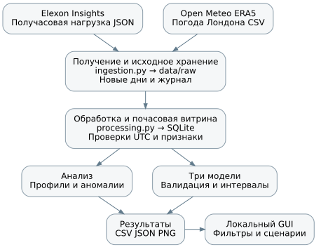

# EnergyScope

EnergyScope — локальная аналитическая система для исследования и краткосрочного прогнозирования электрической нагрузки Великобритании. Она получает данные нагрузки и погоды, формирует почасовую витрину, выявляет закономерности, сравнивает три прогнозные модели и показывает результаты в интерактивном веб-интерфейсе.

Целевой показатель — средняя часовая электрическая нагрузка в **МВт**. Основной горизонт прогноза — **24 часа**. Пользователь может изучить историю, выбрать модель, оценить её точность и пересчитать прогноз при изменении температурного индикатора.

## Содержание

- [Возможности](#возможности)
- [Технологии и требования](#технологии-и-требования)
- [Установка и запуск](#установка-и-запуск)
- [Работа с интерфейсом](#работа-с-интерфейсом)
- [Источники и обработка данных](#источники-и-обработка-данных)
- [Прогнозные модели и проверка качества](#прогнозные-модели-и-проверка-качества)
- [Температурные сценарии](#температурные-сценарии)
- [Архитектура и структура проекта](#архитектура-и-структура-проекта)
- [Настройка](#настройка)
- [Файлы результатов](#файлы-результатов)
- [Локальный HTTP API](#локальный-http-api)
- [Тестирование](#тестирование)
- [Вопросы по запуску](#вопросы-по-запуску)

## Возможности

- Автоматическая загрузка новых завершённых дней из двух источников.
- Хранение исходных ответов, контрольных сумм и журнала загрузок.
- Почасовая витрина SQLite и выгрузки CSV.
- Проверка полноты, дубликатов, допустимости значений и аномальных наблюдений.
- Анализ динамики, суточных и месячных профилей, связи нагрузки с погодой.
- Сезонный наивный прогноз, линейная регрессия Ridge и градиентный бустинг.
- Скользящая временная проверка моделей, оценка MAE, RMSE и покрытия интервала.
- Суточный прогноз с номинальным 90% интервалом.
- Три предустановленных температурных сценария и произвольный сдвиг индикатора.
- Автоматические текстовые выводы и интерактивные графики.

## Технологии и требования

Для запуска используется **Python 3.12**. В Windows требуется доступ к интерпретатору через команду `py -3.12`.

| Компонент | Реализация |
|---|---|
| Вычисления и обработка | Python, NumPy, pandas, SciPy |
| Прогнозные модели | scikit-learn |
| Хранение | SQLite, JSON, CSV |
| Сохранение графиков | Matplotlib |
| Локальный сервер | `http.server` из стандартной библиотеки Python |
| Интерфейс | HTML, CSS, JavaScript, SVG |
| Шрифты | Manrope, IBM Plex Mono; локальные файлы и лицензии OFL в `web/assets/fonts/` |

Версии вычислительных библиотек закреплены в `requirements.txt`. Для установки зависимостей и получения данных нужен доступ к интернету. Сохранённые данные и результаты используются в офлайн-режиме.

## Установка и запуск

Все команды выполняются из папки проекта, содержащей `main.py`, `config.json` и `requirements.txt`.

### Первый запуск из репозитория в Windows

Откройте командную строку `cmd` и выполните:

```bat
git clone https://github.com/dayaalena/EnergyScope.git
cd EnergyScope
py -3.12 -m venv .venv
.venv\Scripts\python.exe -m pip install -r requirements.txt
.venv\Scripts\python.exe main.py --run
start_windows.bat
```

Команда `main.py --run` загружает исходные данные, строит витрину, обучает модели и сохраняет результаты. Ход выполнения отображается в консоли. После завершения `start_windows.bat` открывает веб-интерфейс с подготовленным расчётом.

Адрес интерфейса: **http://127.0.0.1:8765**. Во время работы приложения окно консоли остаётся открытым. Остановка — **Ctrl+C** в консоли.

### Запуск архива с сохранёнными данными

В архиве с подготовленным расчётом находятся папки `data/` и `results/`. Для запуска в Windows достаточно полностью распаковать архив и дважды щёлкнуть `start_windows.bat`.

Скрипт создаёт виртуальное окружение `.venv`, устанавливает зависимости и открывает сохранённый расчёт. После установки библиотек такой запуск работает офлайн.

Папки `data/` и `results/` создаются во время расчёта и указаны в `.gitignore`. При установке из репозитория их формирует первый запуск `main.py --run`.

### Linux и macOS

```bash
git clone https://github.com/dayaalena/EnergyScope.git
cd EnergyScope
python3.12 -m venv .venv
.venv/bin/python -m pip install -r requirements.txt
.venv/bin/python main.py --run
.venv/bin/python main.py --offline
```

### Режимы работы в Windows

| Задача | Команда |
|---|---|
| Открыть сохранённый расчёт | `.venv\Scripts\python.exe main.py --offline` |
| Открыть интерфейс с обновлением из источников | `.venv\Scripts\python.exe main.py` |
| Получить новые данные и выполнить полный расчёт | `.venv\Scripts\python.exe main.py --run` |
| Повторить расчёт по сохранённым исходникам | `.venv\Scripts\python.exe main.py --run --offline` |
| Использовать другой порт | `.venv\Scripts\python.exe main.py --offline --port 8766` |
| Использовать другой файл настроек | `.venv\Scripts\python.exe main.py --config config.json` |
| Запустить сервер с ручным открытием браузера | `.venv\Scripts\python.exe main.py --offline --no-browser` |

В онлайн-режиме новые данные и результаты обновляются с периодом `auto_update_minutes`. Кнопка **«Загрузить и рассчитать»** запускает тот же вычислительный маршрут вручную. В офлайн-режиме она повторяет расчёт по сохранённым исходникам.

## Работа с интерфейсом

В верхней части окна расположены кнопка загрузки и пять вкладок. Розовым выделены активная вкладка и основная серия графика. Серые линии показывают фактические значения или серии сравнения, светлая заливка — прогнозный интервал. Числовые значения и время отображаются с табличными цифрами.

| Вкладка | Содержание | Действия |
|---|---|---|
| **Анализ данных** | Последняя нагрузка, точность выбранной модели, полнота, история нагрузки, суточный профиль, сезонность, текстовые выводы | Задать начало и конец периода, нажать «Применить», выгрузить витрину |
| **Прогноз** | Факт, прогноз, интервал и таблица значений по часам | Выбрать модель, показать 6/12/24 часа, скачать прогнозы |
| **Качество данных** | Полнота, пропуски, дубликаты, недопустимые значения, нетипичные часы, журнал загрузок | Просмотреть проверки и скачать аномальные наблюдения |
| **Проверка моделей** | Метрики валидации, калибровки и теста; последнее тестовое окно; ошибка по горизонту; остатки | Выбрать часть данных, сравнить модели, выгрузить метрики и исторические прогнозы |
| **Сценарии** | Базовый и пересчитанный прогноз Ridge, интервал, изменение среднего прогноза, диапазон применимости | Выбрать готовый сценарий или ввести сдвиг от −10 до +10 °C и нажать «Пересчитать» |

Наведение на график показывает точные значения. История нагрузки на обзорном графике агрегирована до среднего за сутки. Суточный профиль рассчитывается по местному времени `Europe/London`; остальные временные метки подписаны в UTC.

У графика прогноза указаны время его начала и последний доступный факт. Сбор нагрузки охватывает завершённые сутки, онлайн-прогноз начинается от текущего часа расчёта. Расстояние между этими временными отметками отображается на общей временной шкале.

## Источники и обработка данных

### Источники

| Источник | Данные | Формат |
|---|---|---|
| [Elexon Insights INDO](https://developer.data.elexon.co.uk/) | Получасовая электрическая нагрузка Великобритании | JSON |
| [Open-Meteo Historical Weather API ERA5](https://open-meteo.com/en/docs/historical-weather-api) | Почасовая температура, влажность, осадки и ветер в Лондоне | CSV |

Запрос нагрузки направляется на `https://data.elexon.co.uk/bmrs/api/v1/demand/outturn/stream`, запрос погоды — на `https://archive-api.open-meteo.com/v1/archive`. Координаты погодной точки по умолчанию: **51.5074, −0.1278**.

Данные нагрузки предоставляются Elexon/NESO согласно BMRS Data Licence. Источник погодных данных — Open-Meteo/ERA5.

### Загрузка и хранение

Первичная загрузка выполняется частями по календарным месяцам. Следующие запуски получают продолжение после последней сохранённой даты. Граница данных нагрузки — вчерашний завершённый день UTC. Для погоды используется буфер публикации `weather_delay_days`, по умолчанию 7 суток.

Исходные ответы сохраняются в `data/raw/elexon/` и `data/raw/open_meteo/`. Журнал `data/loads.jsonl` содержит время UTC, источник, статус, параметры запроса, размер ответа, SHA-256 и число попыток.

Запись файла выполняется через временный файл с последующей атомарной заменой. Сетевой запрос имеет таймаут 45 секунд и до трёх попыток. При сбое обновления доступен предыдущий успешный снимок результатов.

### Подготовка данных

1. Время приводится к UTC, числовые поля преобразуются к числовому типу.
2. Для повторных измерений нагрузки выбирается последняя публикация по временной метке.
3. Два валидных получасовых значения объединяются в среднюю нагрузку за час. Полнота часа отражается в поле `valid_halfhours`.
4. Пропуски и недопустимые значения отмечаются при проверке качества; для полного часа требуется два валидных измерения.
5. Почасовая нагрузка соединяется с погодой по времени.
6. Формируются признаки моделей и отметки аномальных наблюдений.

Витрина хранится в таблице `hourly` файла `data/energy.sqlite`. Поле `time` — первичный ключ; повторная запись той же витрины сохраняет единственную строку каждого часа. Поля витрины: `time`, `y`, `temperature`, `humidity`, `precipitation`, `wind`, `valid_halfhours`, `publish_time`.

Аномалии определяются по границам 3 IQR прошлой годовой истории и отклонению от недельного профиля. Для недельного профиля используются восемь предыдущих недель и порог `max(3 × 1.4826 × MAD, 20% медианы)`. Отмеченные наблюдения сохраняются в витрине и отдельно выгружаются в `anomalies.csv`.

### Признаки моделей

- Циклические признаки часа, часа недели и дня года, а также признак выходного.
- Лаги нагрузки **48, 168 и 336 часов**.
- Среднее и стандартное отклонение предыдущих 24 часов со сдвигом **48 часов**.
- Погодные индикаторы со сдвигом **336 часов**, то есть 14 суток.
- Температурные преобразования `max(18 − T, 0)` и `max(T − 22, 0)`.

Календарные признаки рассчитываются в часовом поясе `Europe/London`. Медианы заполнения признаков и масштабирование оцениваются на обучающем окне. При исторической проверке учитываются время наблюдения и время публикации нагрузки.

## Прогнозные модели и проверка качества

### Модели

| Модель | Реализация |
|---|---|
| Сезонный наивный прогноз | Повторение значения того же часа предыдущей недели, лаг 168 часов |
| Ridge | Медианное заполнение признаков, `StandardScaler`, линейная регрессия с `alpha=10` |
| Градиентный бустинг | Медианное заполнение признаков, `HistGradientBoostingRegressor`: 100 итераций, до 15 листьев, минимум 40 наблюдений в листе, L2-регуляризация 1 |

### Временная схема

Каждый прогноз строится на **24 часа**. Обучение использует скользящее окно последних **365 суток**, начало очередного прогноза смещается на **5 суток**.

| Часть данных | Окон | Назначение |
|---|---:|---|
| Валидация | 6 | Выбор итоговой модели по минимальному RMSE |
| Калибровка | 8 | Расчёт ширины прогнозного интервала |
| Тест | 8 | Итоговая оценка точности и покрытия |

Всего проверяются **22 последовательных прогнозных окна**. Модели сравниваются на общих часах оценки. Бэктестирование сохраняет прогнозы и метрики каждого окна, ошибку по горизонту и диагностику остатков выбранной модели.

### Метрики и интервал

**MAE** — средняя абсолютная ошибка в МВт. **RMSE** — корень из среднего квадрата ошибки в МВт. **Покрытие** — доля фактических значений, попавших в прогнозный интервал.

Ширина номинального **90% интервала** определяется квантилем абсолютных ошибок на калибровочных окнах с конечновыборочным рангом. Для каждой модели рассчитывается собственная ширина. Фактическое покрытие оценивается на тестовых окнах и показано вместе с метриками.

### Результаты сохранённого расчёта

Снимок сформирован **22.11.2026**. Нагрузка охватывает **01.01.2024–21.11.2026**: **50 688** получасовых измерений и **25 344** полных часа. Полнота нагрузки — **100%**. Погода доступна по **15.11.2026**.

| Модель | RMSE валидации, МВт | MAE теста, МВт | RMSE теста, МВт | Покрытие на тесте |
|---|---:|---:|---:|---:|
| Сезонный наивный прогноз | 2400,0 | 2334,4 | 2953,2 | 78,1% |
| Ridge | 1831,7 | 1701,1 | 2183,4 | 85,4% |
| Градиентный бустинг | 1838,7 | 1557,4 | 2045,5 | 81,8% |

По RMSE валидации выбрана **Ridge**. Её тестовый RMSE ниже базового на **26,1%**. Полуширина интервала Ridge — **2954,8 МВт**, фактическое покрытие на тесте — **85,4%**.

В этом снимке последний факт относится к **21.11.2026, 23:00 UTC**, прогноз начинается **22.11.2026, 19:00 UTC**. Офлайн-пересчёт использует сохранённую точку прогноза. Онлайн-пересчёт формирует новый снимок с актуальными датами и результатами.

## Температурные сценарии

Сценарный модуль оценивает чувствительность прогноза **Ridge** к температурному индикатору. Базовый индикатор повторяет температуру того же часа 14 суток назад. Сценарий добавляет к нему выбранный сдвиг на всём горизонте и пересчитывает температурные преобразования при фиксированных остальных признаках.

| Сценарий | Сдвиг индикатора |
|---|---:|
| Холоднее | −3 °C |
| Базовый | 0 °C |
| Теплее | +3 °C |

Произвольный сдвиг задаётся числом от **−10 до +10 °C**. На панели отображаются базовый и сценарный прогнозы, интервал, изменение среднего прогноза и диапазон применимости.

Диапазон определяется минимальным и максимальным значением температурного индикатора на обучении. Для сохранённого снимка он равен **−4,4…35,5 °C**. Выход сценарных значений за этот диапазон отмечается сообщением об экстраполяции. Сценарные интервалы используют ширину базовой калибровки Ridge.

## Архитектура и структура проекта



Общий маршрут: получение данных → сохранение исходников → обработка и признаки → анализ и модели → результаты → интерфейс. Командный запуск и веб-интерфейс используют функции одного вычислительного конвейера.

| Путь | Назначение |
|---|---|
| `main.py` | Чтение конфигурации, параметры запуска и вызов модулей |
| `config.json` | Настройки источников, временных окон, интервала и сервера |
| `requirements.txt` | Версии вычислительных библиотек |
| `start_windows.bat` | Подготовка окружения и открытие сохранённого расчёта в Windows |
| `modules/ingestion.py` | Получение данных, кеш и повторные попытки |
| `modules/storage.py` | SQLite, журнал, контрольные суммы и атомарная запись |
| `modules/processing.py` | Контроль качества, объединение данных и признаки |
| `modules/analysis.py` | Статистики, профили, аномалии, остатки и текстовые выводы |
| `modules/models.py` | Модели, валидация, интервалы и сценарии |
| `modules/pipeline.py` | Последовательность вычислительных этапов |
| `modules/visualization.py` | Сохранение графиков PNG |
| `modules/gui.py` | HTTP-сервер, обновление данных, сценарный ввод и выгрузки |
| `web/index.html` | Разметка интерфейса |
| `web/assets/app.css` | Оформление интерфейса |
| `web/assets/app.js` | Вкладки, фильтры, графики, таблицы и запросы к серверу |
| `web/assets/fonts/` | Локальные шрифты и лицензии |
| `docs/` | Схема архитектуры в DOT, SVG и PNG |
| `tests/test_system.py` | Автоматические проверки обработки и прогнозирования |

## Настройка

Параметры задаются в `config.json`.

| Параметр | По умолчанию | Назначение |
|---|---|---|
| `start_date` | `2024-01-01` | Начало первичной загрузки |
| `end_date` | `null` | Конец загрузки; `null` соответствует вчерашнему завершённому дню UTC |
| `latitude` | `51.5074` | Широта погодной точки |
| `longitude` | `-0.1278` | Долгота погодной точки |
| `weather_location` | `Лондон` | Название погодной точки в конфигурации |
| `weather_delay_days` | `7` | Буфер доступности погоды в сутках |
| `weather_lag_hours` | `336` | Сдвиг погодных индикаторов в часах |
| `horizon_hours` | `24` | Расчётный горизонт; поддерживаемое значение — 24 часа |
| `train_days` | `365` | Длина обучающего окна в сутках |
| `validation_folds` | `6` | Число валидационных окон |
| `calibration_folds` | `8` | Число калибровочных окон |
| `test_folds` | `8` | Число тестовых окон |
| `fold_step_days` | `5` | Шаг начала прогнозных окон в сутках |
| `interval_level` | `0.9` | Номинальный уровень прогнозного интервала |
| `request_timeout_seconds` | `45` | Таймаут одного HTTP-запроса |
| `request_attempts` | `3` | Максимальное число попыток запроса |
| `auto_update_minutes` | `60` | Период обновления в онлайн-режиме; `0` — ручное обновление |
| `port` | `8765` | Порт локального сервера |
| `seed` | `42` | Начальное состояние генератора случайных чисел модели |

Для отдельного эксперимента с другим периодом или координатами используется отдельная папка проекта с новым кешем `data/raw/`. Для воспроизведения сохранённого снимка используются соответствующие исходники, конфигурация и режим `--run --offline`.

## Файлы результатов

Все вычислительные результаты записываются в `results/`.

| Файл | Содержание |
|---|---|
| `hourly.csv` | Почасовая витрина нагрузки и погоды |
| `features.csv` | Признаки моделей |
| `anomalies.csv` | Временные отметки нетипичной нагрузки и правило выделения |
| `model_metrics.csv` | Агрегированные метрики моделей по частям данных |
| `fold_metrics.csv` | Метрики и размер обучения каждого прогнозного окна |
| `backtest_predictions.csv` | Факт, прогноз, остаток и интервал исторических окон |
| `forecast.csv` | Прогнозы трёх моделей на следующие 24 часа |
| `scenarios.csv` | Результаты сценариев −3/0/+3 °C |
| `quality.json` | Показатели качества данных |
| `diagnostics.json` | Среднее, разброс и корреляции остатков |
| `current.json` | Согласованный снимок данных и результатов для интерфейса |
| `figures/` | Графики динамики, профилей, качества и прогнозов |

В `data/scenario_model.pkl` сохраняются обученная Ridge, признаки горизонта, ширина интервала и диапазон температурного индикатора для сценарного пересчёта.

## Локальный HTTP API

Сервер по умолчанию слушает **127.0.0.1:8765**. Интерфейс обращается к следующим маршрутам:

| Метод и маршрут | Назначение |
|---|---|
| `GET /` | Страница интерфейса |
| `GET /api/data` | Текущий снимок результатов |
| `GET /api/status` | Этап расчёта, состояние обновления и версия снимка |
| `GET /api/logs` | Последние записи журнала загрузок |
| `POST /api/update` | Запуск вычислительного конвейера в фоновом потоке |
| `POST /api/scenario` | Пересчёт сценария; JSON-тело, например `{"delta": 3}` |
| `GET /download/<имя>.csv` | Выгрузка предусмотренного CSV-файла |

Для выгрузки доступны `hourly.csv`, `forecast.csv`, `model_metrics.csv`, `backtest_predictions.csv` и `anomalies.csv`. Клиент опрашивает состояние каждые три секунды и получает обновлённый снимок при изменении его версии.

## Тестирование

В Windows:

```bat
.venv\Scripts\python.exe -m unittest discover -s tests -v
```

В Linux и macOS:

```bash
.venv/bin/python -m unittest discover -s tests -v
```

Восемь проверок охватывают неполные часы, смену времени, повторную запись витрины, повторную загрузку, отказ сети, временную доступность погодных признаков, влияние будущих данных и независимость выбора модели от тестовых ответов.

## Вопросы по запуску

**Как открыть страницу вручную?** Перейдите на `http://127.0.0.1:8765` во время работы программы. При смене порта укажите выбранный порт в адресе.

**Как получить данные после клонирования?** Установите зависимости и выполните `.venv\Scripts\python.exe main.py --run`. По завершении откройте интерфейс командой `start_windows.bat`.

**Как обновить данные из приложения?** Запустите `.venv\Scripts\python.exe main.py` и нажмите «Загрузить и рассчитать». Новые дни добавятся к сохранённой истории, затем обновятся витрина, модели и результаты.

**Как повторить сохранённый расчёт?** Выполните `.venv\Scripts\python.exe main.py --run --offline`. Программа использует сохранённые исходники и сохранённую точку начала прогноза.

**Как запустить вторую копию?** Выберите другой порт, например `.venv\Scripts\python.exe main.py --offline --port 8766`, и откройте `http://127.0.0.1:8766`.

**Как завершить работу?** Нажмите Ctrl+C в окне консоли, где запущен сервер.
